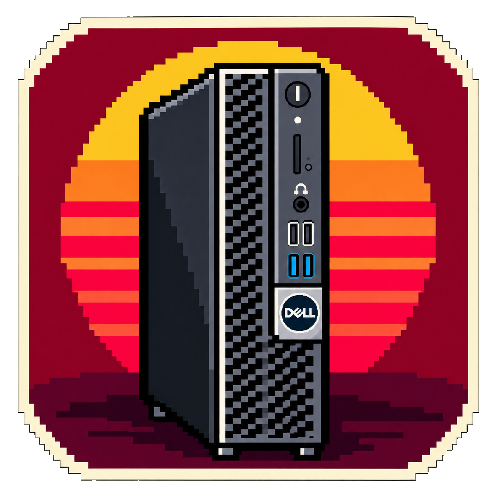

[README.md](https://github.com/user-attachments/files/33439121/README.md)[Uploading README.md…# OptiPlex Now

A compact, unofficial Linux GTK launcher for a personal remote PC, with cross-desktop tray quick actions. Games, Videos, Music, Files, Downloads, SSH, power, storage, and live hardware info.



## Install

Download `OptiPlex-Now_1.11.3_amd64.deb` from the **Releases** section, then double-click it in Linux Mint or install with:

```sh
sudo apt install ./OptiPlex-Now_1.11.3_amd64.deb
```

This upgrades earlier `optiplex-desk` installations and keeps existing local settings.

## Tray quick actions (XFCE, KDE Plasma, COSMIC)

OptiPlex Now prefers the modern StatusNotifierItem (SNI) tray protocol through
Ayatana AppIndicator when the desktop hosts a status notifier. It falls back to
GTK3 legacy status icons on desktops using the XFCE Notification Area.

In the tray menu: Open Window, Games (Steam), Videos, Music, Files, Downloads,
Terminal, System Info, Settings, Quit. Modern SNI trays generally use **left
click to open the menu**, while the legacy XFCE icon uses **left click to toggle
the window**. Closing or minimizing hides the window if a functional tray exists.
A desktop without tray support exits when closed.

The tray uses a **borderless pixel-art sunset icon** at 16, 22, 24, 32, 48, and 64 pixels.
The framed red sunset artwork remains the desktop launcher/window icon. Both
assets use genuine transparent RGBA backgrounds. The build preserves the alpha
channel at every icon size, avoiding the black rectangular matte in earlier builds. XFCE groups
all notification icons in its panel item; you cannot individually drag them.
To position OptiPlex Now independently, pin the app to an XFCE Launcher panel
item rather than trying to move the notification-area icon.

If you have no SNI host installed, ensure your desktop provides a notification
area. For Mint/XFCE, the **Status Notifier Plugin** is preferred; the older
**Notification Area** is supported as a fallback. For other desktops the
system tray integration must be enabled by the desktop.

## Connect

Run **OptiPlex Now**, connect to Tailscale, then complete the setup wizard. SSH and Wolf/Moonlight pairing happen once per computer. **Games** connects straight to the `Steam` application advertised by Wolf if Moonlight is paired. Existing AppImage and Flatpak Moonlight installations are supported.

The setup wizard fills Videos, Music and Downloads from a preset and checks each configured service automatically on the Services screen. It checks Wolf reachability without blocking setup. The **Files** shortcut uses the installed file manager for SFTP. On COSMIC, it mounts the share using GVFS before opening its local mount path, requiring working GVFS SFTP support. Videos and other web services open through the desktop default browser.

Settings include **Export My OptiPlex** for a connection-only preset and **Export Full Backup** for an encrypted archive of your personal SSH key and supported Moonlight configuration. Never upload a full backup or SSH keys to GitHub. Imported full backups belong only on computers you control. Tailscale must be authenticated separately.

## Build from source

Build host: x86-64 Linux, GCC, `make`, `binutils`, `curl`, GTK 3 and Gio runtime libraries, fontconfig, and OpenSSL development library (for backup helper).

```sh
make
make package
```

`make` downloads **Inter** and **Limelight** from the upstream Google Fonts repository on the **build machine only**, compiles the GTK app and encrypted-backup helper, and generates `dist/OptiPlex-Now_1.11.3_amd64.deb`. End users of the `.deb` do **not** need Python or the build tools.

The binary includes embedded font data under the SIL Open Font License 1.1. See `FONT-NOTICES.md` and `OFL-1.1.txt`.

## Notes

- Only 64-bit Debian/Ubuntu-based Linux is packaged. Windows support is not included.
- The app uses Tailscale and SSH for remote management, plus Moonlight/Wolf for game streaming. It does not install or configure Wolf on the server.
- Wolf abandoned-session cleanup is **not** implemented by this client.
- Avoid installing private keys on borrowed computers; use the connection-only preset instead.
- The launcher is an independent project, **not affiliated with or endorsed by Dell**.

## Source code and licensing

The application's source is provided for reference and personal modification. No software license has been selected for the application code yet. Add one before accepting outside contributions or claiming that the project is open source.
]()
